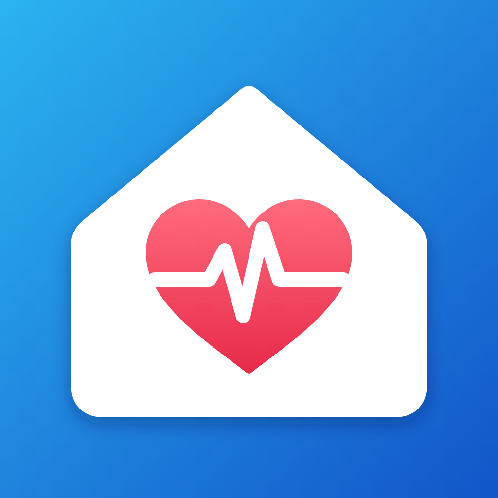

<p align="center">
  
</p>

<h1 align="center">Health Hook</h1>

<p align="center">
  Send your Apple Health data to <b>your own Home Assistant</b>: no cloud, no account, no subscription.<br>
  <a href="#français">Français plus bas</a>
</p>

---

Health Hook is a small iOS app (SwiftUI, no dependencies) that reads the Apple Health data you choose and posts it
as JSON to a [Home Assistant](https://www.home-assistant.io) webhook. A ready-made Home Assistant package turns it into
sensors, keeps a daily journal and can optionally write a short AI summary of your health trends.

The Home Assistant companion app does not expose HealthKit data; Health Hook fills that gap. Anything that writes to
Apple Health works as a source: iPhone, Apple Watch, smart rings, scales, blood pressure monitors…

## Features

- **~50 metrics**, selectable in the app: activity (steps, distances, energy, exercise…), heart (heart rate with daily
  min / avg / max, resting HR, HRV, blood oxygen, VO2 max, blood pressure…), sleep, body (weight, body fat…),
  mobility, sound exposure, nutrition.
- **Sends when you open the app**, when you pull to refresh, from a `healthhook://send` link (e.g. in a Home Assistant
  notification) and in the background when iOS allows it.
- **Last 7 days** in every payload, so Home Assistant catches up on days when the app was not opened.
  **One-tap import of a full year** of history.
- **Home Assistant package**: one sensor per metric (long-term statistics included), a daily **journal**
  (`journal.jsonl`, one line per day, kept forever, ~1 KB/day), an **app expiration** sensor and reminder.
- **Optional AI summary** with any Home Assistant AI Task provider (OpenAI, Anthropic, Google, Ollama…): one sentence
  on your trend and one suggestion, only when there is new data. The input sent to the model has a fixed size,
  whatever the length of your history.
- The webhook URL is stored in the iOS Keychain. Health data only goes to your Home Assistant.

## How it works

```
Apple Health ──(HealthKit, on the iPhone)──▶ Health Hook ──HTTPS POST──▶ Home Assistant webhook
                                                                          ├─ sensors  sensor.health_hook_*
                                                                          ├─ journal  /config/health_hook/journal.jsonl
                                                                          └─ (optional) AI summary + notification
```

## Requirements

- A **Mac** with **Xcode 15+** and [XcodeGen](https://github.com/yonaskolb/XcodeGen) (`brew install xcodegen`).
- An **iPhone** with **iOS 17+**.
- An **Apple ID**. A free account works (the app must then be reinstalled every 7 days, see below).
- **Home Assistant 2024.10+** reachable from the iPhone over HTTPS (Home Assistant Cloud, reverse proxy, VPN…);
  **2025.8+** for the optional AI summary (AI Task).

The app is not on the App Store: you build it yourself with Xcode. That is what keeps it free and private.

## Setup

### 1. Home Assistant

1. Enable packages in `configuration.yaml`, if not done yet:
   ```yaml
   homeassistant:
     packages: !include_dir_named packages
   ```
2. Add a random webhook id to `secrets.yaml` (`openssl rand -hex 24` gives one):
   ```yaml
   health_hook_webhook_id: 3f9c…
   ```
3. Copy [`homeassistant/packages/health_hook.yaml`](homeassistant/packages/health_hook.yaml) to `/config/packages/`
   and [`homeassistant/health_hook/journal.py`](homeassistant/health_hook/journal.py) to `/config/health_hook/`.
   Optional: [`health_hook_summary.yaml`](homeassistant/packages/health_hook_summary.yaml) for the AI summary.
4. In `health_hook.yaml` (and `health_hook_summary.yaml`), replace `notify.notify` with your phone's notify action
   (e.g. `notify.mobile_app_my_iphone`).
5. Check the configuration and restart Home Assistant.

Your webhook URL is `https://<your Home Assistant URL>/api/webhook/<the id>`. Treat it like a password: anyone who has
it can write to these sensors.

### 2. The app

```bash
git clone https://github.com/KMCODE-organisation/health-hook.git
cd health-hook
```

Create your personal settings file (ignored by git, so `git pull` never conflicts with it):

```bash
cp Local.xcconfig.example Local.xcconfig
```

and fill it in:

- `BUNDLE_ID_PREFIX`: something unique to you (e.g. `com.yourname`); the app id becomes `<prefix>.healthhook`.
- `DEVELOPMENT_TEAM`: your Team ID. If you don't know it, leave it empty, open the project, pick your team in
  *Signing & Capabilities*, then run `grep -m1 DEVELOPMENT_TEAM HealthHook.xcodeproj/project.pbxproj`.

```bash
xcodegen
open HealthHook.xcodeproj
```

On the iPhone, enable **Developer Mode** (Settings → Privacy & Security), plug it in, and press ▶︎ in Xcode.
The first time, trust your certificate in Settings → General → VPN & Device Management.

### 3. First launch

1. Paste the webhook URL in the app and tap **Save**.
2. Allow access to the Health data (iOS asks once per data type).
3. Choose the data to send in **Data to send**.
4. Optional: tap **Send 1 year of history** to fill the journal.

## Free Apple account: the 7-day limit

With a free account, the signing profile expires 7 days after install and the app stops opening. Two helpers:

- **Reminder**: the app sends its expiration date; Home Assistant notifies you the day before
  (`sensor.health_hook_app_expiration`).
- **Automatic reinstall** from your Mac: [`tools/reinstall.sh`](tools/reinstall.sh), installed as a launchd agent by
  `./tools/install-auto-reinstall.sh`. Every hour, when the app expires in less than 2 days and the iPhone is on the
  same Wi-Fi as the Mac (tick *Connect via network* once in Xcode → Devices and Simulators) or plugged in, it pulls,
  rebuilds, renews the profile and reinstalls. Log: `~/Library/Application Support/HealthHook/reinstall.log`.

With a paid Apple Developer account, profiles last one year.

## Payload

```json
{
  "steps": 8342,
  "sleep": 7.2,
  "heart_rate": 64, "heart_rate_min": 52, "heart_rate_avg": 71, "heart_rate_max": 148,
  "hrv": null,
  "dates": { "heart_rate": "2026-11-23T21:58:00Z" },
  "days": [ { "date": "2026-11-17", "steps": 10275, "sleep": 6.9, "heart_rate_avg": 70 }, "…7 days" ],
  "source": "open",
  "sent_at": "2026-11-23T22:12:42Z",
  "expires_at": "2026-11-30T16:42:11Z"
}
```

- One top-level key per **selected** metric. `null` = selected but no data: daily totals become `0` in Home Assistant,
  other sensors become *unknown*. Unselected metric = key absent: the sensor keeps its value.
- Daily totals (steps, energy, nutrition…) are **today's** totals; other metrics are the **latest sample** (its date in
  `dates`). Sleep is the night that ended today.
- `days`: daily totals / averages for the last 7 days (30-day batches for a history import).
- `source`: `open`, `manual` (pull to refresh, triggers the AI summary), `link`, `background`, `settings`, `history`.

Keys and units: [`HealthHook/Catalog.swift`](HealthHook/Catalog.swift). The Home Assistant package is generated from
[`tools/generate_ha_package.py`](tools/generate_ha_package.py): add a metric in both places.

## Privacy

Health Hook has no server and no analytics. Data is read on the iPhone and sent only to the webhook URL you enter.
The optional AI summary sends aggregated figures to the AI provider you configured in Home Assistant; use a local
model (e.g. Ollama) to keep everything at home.

## Limitations

- iOS keeps Health data encrypted while the iPhone is locked: syncs only work when it is unlocked.
- Background refresh is decided by iOS and not guaranteed; opening the app always sends.
- Each user builds the app with their own Apple ID (no App Store or TestFlight distribution).

## Contributing

Issues and pull requests are welcome: see [CONTRIBUTING.md](CONTRIBUTING.md) (adding a Health metric is a
three-file change). Please never post your webhook URL or real health data.

## License

[MIT](LICENSE). Not affiliated with Apple or the Open Home Foundation. Health Hook is not a medical device and its
summaries are not medical advice.

---

## Français

**Health Hook** envoie les données d'Apple Santé que tu choisis vers **ton propre Home Assistant**, sans cloud ni
abonnement. L'app iOS (SwiftUI, sans dépendance) envoie un JSON à un webhook ; le package Home Assistant fourni crée un
capteur par donnée, tient un **journal quotidien** et peut rédiger un **bilan court par IA** (facultatif).

**Ce qu'il faut** : un Mac avec Xcode 15+ et XcodeGen, un iPhone en iOS 17+, un Apple ID (un compte gratuit suffit :
l'app doit alors être réinstallée tous les 7 jours), un Home Assistant joignable en HTTPS depuis l'iPhone.

**Installation**
1. Home Assistant : active les packages, ajoute `health_hook_webhook_id` dans `secrets.yaml`, copie
   `homeassistant/packages/health_hook.yaml` dans `/config/packages/` et `homeassistant/health_hook/journal.py` dans
   `/config/health_hook/` (et `health_hook_summary.yaml` pour le bilan IA), remplace `notify.notify` par la
   notification de ton téléphone, redémarre.
2. L'app : `cp Local.xcconfig.example Local.xcconfig`, renseigne `BUNDLE_ID_PREFIX` et `DEVELOPMENT_TEAM` dans
   `Local.xcconfig` (ignoré par git), puis `xcodegen`,
   `open HealthHook.xcodeproj`, Mode développeur sur l'iPhone, ▶︎.
3. Premier lancement : colle l'URL `https://<ton Home Assistant>/api/webhook/<id>`, autorise Santé, choisis les données,
   puis « Envoyer 1 an d'historique » si tu veux remplir le journal.

**Envois** : à l'ouverture de l'app, en tirant vers le bas (déclenche le bilan IA), via le lien `healthhook://send`, et
en arrière-plan quand iOS le permet. Chaque envoi contient aussi les 7 derniers jours.

**Compte gratuit (7 jours)** : Home Assistant prévient la veille de l'expiration, et `tools/install-auto-reinstall.sh`
installe sur le Mac une tâche qui réinstalle l'app toute seule quand il reste moins de 2 jours (iPhone sur le même Wi-Fi
que le Mac, ou branché).

**Confidentialité** : aucun serveur, aucune statistique d'usage ; les données ne vont qu'à ton Home Assistant (et, si tu
actives le bilan, au fournisseur d'IA que tu as configuré : préfère un modèle local pour tout garder chez toi).
L'interface de l'app est en anglais et en français.

**Contribuer** : issues et pull requests bienvenues (en anglais de préférence), voir [CONTRIBUTING.md](CONTRIBUTING.md).
